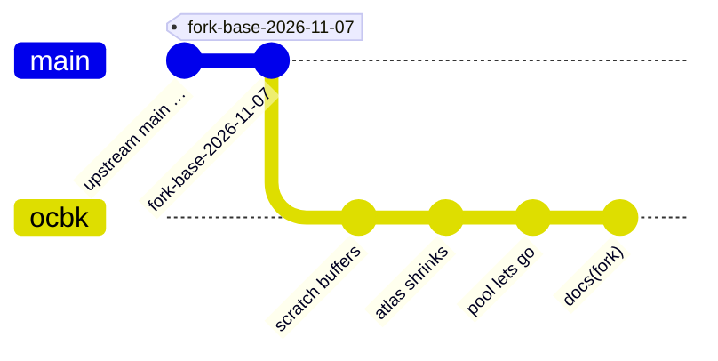

# vello fork docs

This fork of [vello](https://github.com/linebender/vello) exists to make the compute renderer
small enough for a desktop shell, used by the
[amane](https://github.com/098765434/amane) fork and the
[amane-shell](https://github.com/098765434/amane-shell) desktop. It is branch `ocbk` on top of
upstream `main` at the tag `fork-base-2026-11-07` (commit `c161b8ae`, 50 commits after
`v0.11.0`). The workspace version is still `0.11.x`, which is what lets amane's `vello = "0.11"`
accept the patch. Upstream's own docs and code are left as they are; everything the fork adds is
here. The fork's commits: `git log fork-base-2026-11-07..ocbk`. The three code commits, one per
change:

- `vello_encoding: shell-sized scratch buffers`
- `vello_encoding: retire unused atlas images and shrink the atlas`
- `vello: retire pooled buffers after 60 unused runs, Renderer::release_scratch`

## Using the fork

### Why it exists

Upstream's compute renderer (`vello`, `vello_encoding`) is sized for its test scenes and
paris-30k and keeps every GPU buffer it ever made. A desktop shell draws a few hundred paths a
frame, sits idle most of the time, and shares an integrated GPU's memory with everything else on
the machine. The fork changes three things, each a commit of its own: the scratch buffers are
sized for a shell's scenes, the image atlas shrinks when its images go, and the buffer pool lets
go of what no run takes any more.

### Shell-sized scratch buffers

`research/vello_encoding/src/config.rs` sizes the bump-allocated scratch buffers that the
compute pipeline fills on the GPU: `tiles`, `lines`, `seg_counts`, `segments`, `ptcl`,
`bin_data` and `blend_spill`. Upstream hand-picked them "to accommodate the vello test scenes as
well as paris-30k", about 165 MB a set, and `vello::Renderer`'s pool keeps every buffer it ever
made for the renderer's lifetime. A desktop shell drawing a few hundred paths a frame paid some
360 MB of GPU memory for that, measured on an integrated Radeon.

The fork sizes them for a shell's scenes:

| Buffer | Upstream | Fork | Bytes (fork) |
|---|---|---|---|
| `bin_data` | 2¹⁸ | 2¹⁸ | 1 MB |
| `tiles` | 2²¹ | 2¹⁸ | 2 MB |
| `lines` | 2²¹ | 2¹⁸ | 6 MB |
| `seg_counts` | 2²¹ | 2¹⁸ | 2 MB |
| `segments` | 2²¹ | 2¹⁸ | 6 MB |
| `blend_spill` | 2²⁰ | 2²⁰ | 4 MB |
| `ptcl` | 2²³ | 2²¹ | 8 MB |

About 29 MB a set instead of 165. Measured on amane's examples (2026-10-26, read back from the
GPU), the heaviest scene is `canvas`, a stroked clock face and spirograph at 1216×320: 36k lines,
37k segments, 940 tiles. `blur_shapes` at full output (2881×1769) takes 11.7k tiles and 3.1k
segments. The amane-shell desktop itself (widgets, launcher, Quick Settings, bar, dock; 231 runs)
peaks at 38.7k tiles, 104k ptcl entries, 3.5k segments and 1.1k lines. Each limit is 3–7× above
the largest value seen. amane's `gradient` example went from 193 MB to 65 MB of VRAM.

**An overflow is silent.** The shaders set `BumpAllocators::failed`, coarse and fine
rasterisation exit early, and `render_to_texture` still returns `Ok`: the run comes out blank or
partial. Two ways to check a scene's headroom:

- `vello_encoding::use_upstream_scratch(true)` (reached from `vello` as
  `vello::low_level::vello_encoding`), called before the first render, restores upstream's sizes;
  amane calls it when started with `AMANE_VELLO_SCRATCH=upstream`, so no rebuild is needed. If a
  blank run fills in, the scene overflowed.
- vello's `debug_layers` cargo feature makes `render_to_texture_async` read the `BumpAllocators`
  counters back from the GPU: `failed`, plus what the run took of each buffer. amane's
  `vello-stats` feature draws that way and prints a `scratch …` line per vello run under
  `AMANE_FRAMES=1`. (vello's `bump_estimate` feature gives a CPU-side bound instead, but it
  overshoots stroked scenes by 10×.)

### An image atlas that shrinks

`research/vello_encoding/src/image_cache.rs` keeps every image a scene draws in one square
atlas texture that doubles as needed, up to 8192² (256 MB). Upstream evicts an image only when a
new one doesn't fit, and the atlas keeps the largest size it ever grew to. amane's blur copies
and `draw_image` pictures go through it (a full-output blur copy forces 4096², two of them
8192²), so a shell paid for them long after the surface that drew them hid.

The fork retires images unused for 120 resolve passes at the start of each pass
(`RETIRE_AFTER_GENERATIONS`, far above upstream's 2-pass eviction so an image one window draws
every few passes isn't uploaded again and again), and then halves the atlas while everything
left fits in half the side with at most half the area used, repacking as it goes. The renderer
sees the new size, frees the old texture and uploads the survivors again. Covered by
`retired_entries_free_the_atlas_and_shrink_it` in the crate's tests.

### A scratch pool that lets go

`research/vello_research/src/wgpu_engine.rs`'s `ResourcePool` hands every run its scratch
buffers and scene uploads and takes them back afterwards, keyed by size class, usage and name.
Upstream keeps all of them for the renderer's lifetime: the scratch set (29 MB in the fork) sits
on the GPU while nothing draws, and a scene that was once large leaves a buffer behind in every
size class it passed through.

The fork does two things:

- Each buffer given back is stamped with the run, and buffers no run took again for 60 runs
  (`RETIRE_AFTER_RUNS`) are dropped at the end of a run. The scratch set every run takes is
  never that old; the stragglers of a large scene are.
- `Renderer::release_scratch()` drops the whole pool. The shaders and the image atlas stay, so
  the next run only allocates. A shell calls it after some seconds without a run (amane:
  `AMANE_VELLO_IDLE`, 30 s by default) and polls the device once, since wgpu frees dropped
  buffers only on a poll.

### Depending on it

Both `amane` and `amane-shell` patch both crates from their root manifests (a
`[patch.crates-io]` only applies from the root workspace, and amane is a git dependency of the
shell):

```toml
[patch.crates-io]
vello = { git = "https://github.com/098765434/vello", rev = "<ocbk commit>" }
vello_encoding = { git = "https://github.com/098765434/vello", rev = "<ocbk commit>" }
```

The nix builds need the fork's content hash in `cargoLock.outputHashes`, once per crate
(`vello-0.11.0` and `vello_encoding-0.11.0`, the same hash since they come from the same
checkout); the first build prints the expected `sha256-…` on mismatch.

### Knobs

Everything the fork adds to the API, in one place:

| Knob | Where | What it does |
|---|---|---|
| `vello_encoding::use_upstream_scratch(bool)` | `research/vello_encoding/src/config.rs`; from `vello` as `vello::low_level::vello_encoding::use_upstream_scratch` | Called before the first render, `true` restores upstream's scratch sizes. amane maps `AMANE_VELLO_SCRATCH=upstream` to it. |
| `Renderer::release_scratch()` | `research/vello_research/src/lib.rs` | Drops the buffer pool; shaders and the image atlas stay. Poll the device once afterwards. amane calls it after `AMANE_VELLO_IDLE` seconds (30 by default). |
| `debug_layers` cargo feature | `research/vello_research/Cargo.toml` (upstream's feature) | `render_to_texture_async` reads the `BumpAllocators` counters back from the GPU, so an overflow and each buffer's use can be seen. amane's `vello-stats` feature builds with it. |

## Maintaining the fork

### Where things are

- `upstream` remote: `https://github.com/linebender/vello.git`. The fork follows upstream `main`,
  and the fork point is tagged `fork-base-<date>` (now `fork-base-2026-11-07`).
- The fork's commits touch only `research/vello_encoding` and `research/vello_research`, which
  upstream rarely changes, so a rebase is usually clean. Upstream files are not edited, with one
  exception: a one-line banner at the top of the root `README.md` that points at `FORK.md`.
- `ocbk-pre-tidy` keeps the commits from before the last rebase, so revisions pinned before it
  can still be fetched.
- `.github/workflows/fork.yml` is the fork's own CI (format, clippy and tests for
  `vello_encoding` and `vello`, a workspace check, and amane-shell's `scripts/lint-terms` on the
  lines added since the fork point). Upstream's `ci.yml` and `web-demo.yml` stay as they are in
  the tree and are disabled in the fork's Actions settings, since they expect upstream's
  secrets, LFS cache and `main` branch.



### Rebasing

One commit per feature (scratch sizes, the shrinking atlas, the pool that lets go), rebased onto
the new fork point:

```sh
git fetch upstream
git tag fork-base-<date> upstream/main
git rebase --onto fork-base-<date> <old fork-base> ocbk
git range-diff <old fork-base>..<old ocbk> fork-base-<date>..ocbk
cargo test -p vello_encoding && cargo check --workspace
```

Then update the `fork-base-<date>` in this file, in `FORK.md` and in `.github/workflows/fork.yml`
(the `lint-terms --diff` base). The workspace version must stay `0.11.x` for amane's
`vello = "0.11"` to take the patch; if upstream bumps it, amane's dependency moves with it. Then
bump the `rev` and the `outputHashes` in amane and amane-shell.

### Retiring the fork

Upstream has moved its effort to the sparse-strips renderers (`vello_cpu`, `vello_gpu`), where
this problem does not exist. Moving amane to `vello_gpu` once it has feature parity and a
stable API retires this fork. The fork's changes are not proposed upstream, in line with
upstream's `AGENTS.md` and the Linebender LLM contribution policy.
